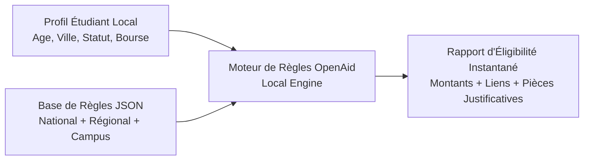

# 🤝 OpenAid — Le moteur libre d'éligibilité aux aides étudiantes

[](LICENSE)
[](#vie-privée)
[](CONTRIBUTING.md)

> **L'alternative éthique, open-source et communautaire aux calculateurs commerciaux d'aides étudiantes.**

---

## 💡 Pourquoi OpenAid ?

En France, plus de **30 % des étudiants renoncent à leurs aides** (bourses, aides d'urgence CROUS, FSDIE de leur faculté, épiceries solidaires, réductions transports) par manque d'information ou découragement face au labyrinthe administratif.

Les solutions commerciales existantes (type Wizbii) imposent de fournir numéro de téléphone et adresse mail pour revendre ces données à des banques, mutuelles et assureurs partenaires.

**OpenAid prend le contre-pied total :**
- 🛡️ **100 % Local & Anonyme :** Aucun compte obligatoire, aucune collecte de données, calcul exécuté sur l'appareil.
- 🌍 **Couverture globale et locale :** Intègre les aides nationales (CROUS, CAF, Pass Rail) ET les aides locales invisibles (FSDIE, associations Cop1, Linkee, aides régionales).
- 🤝 **Crowdsourcé :** N'importe quelle association ou étudiant peut ajouter une aide locale via une simple Pull Request.

---

## 🏛️ Architecture Technique



---

## 🚀 Démarrage Rapide

```bash
# Cloner le dépôt
git clone https://github.com/votre-user/openaid.git
cd openaid

# Installer les dépendances
npm install

# Lancer la simulation interactive en console
npm run start
```
